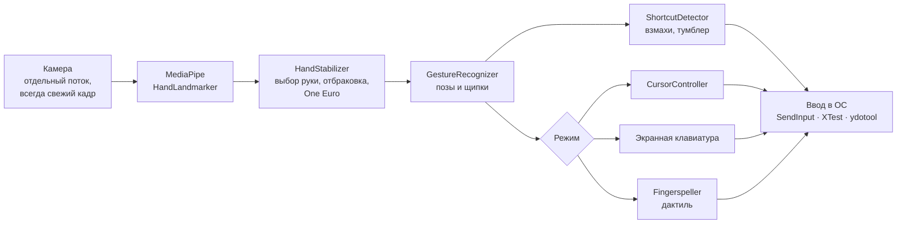

# Как это устроено и почему так

## Конвейер



Движок (`engine/engine.py`) крутится в своём потоке и публикует неизменяемый `FrameState`
в интерфейс; мышь двигается прямо из этого потока, чтобы задержка была минимальной.

## Трекер

На записях сравнивались MediaPipe Tasks и RTMPose (rtmlib, ONNX): MediaPipe — 95% кадров с рукой
и 25 мс/кадр на CPU, RTMPose-m — 82% и ~290 мс при том же дрожании. Поэтому основа — MediaPipe,
а его типичные сбои гасятся отдельным слоем `tracking/stabilizer.py`:

* выбирается одна активная рука и сопровождается (лица и чужие руки игнорируются);
* кадры с «развалившимся» скелетом отбрасываются по метрическим длинам костей
  (сравнение с персональным эталоном, который подстраивается на лету), вместо них
  до 200 мс держится последняя хорошая поза;
* скачки руки через полкадра принимаются только при подтверждении следующим кадром;
* сглаживание One Euro: нет дрожания в покое и нет задержки при быстром движении.

Трекер вынесен за интерфейс `tracking/base.py`, так что другой бэкенд подключается без изменений
остального кода.

## Курсор

По умолчанию режим «тачпад»: движение руки двигает курсор с кривой ускорения (медленно — точно,
быстро — через весь экран), поэтому можно держать локоть на столе. Якорь — центр ладони, а не
кончик пальца, и щипок не сдвигает курсор. Дополнительно при начале щипка курсор откатывается на
~90 мс назад и замирает, пока рука явно не сдвинется (тогда клик превращается в перетаскивание).
Есть режим «указка» (абсолютное отображение рабочей зоны кадра на экран).

## Жесты

Пороги поз и щипков откалиброваны на размеченном датасете (`training/calibrate_poses.py`).
Например, щипок требует, чтобы указательный не был поджат, иначе кулак («А» в дактиле) давал бы
ложный клик. Все жесты с удержанием показывают прогресс кольцом у курсора.

**Жесты-команды** (`engine/shortcuts.py`) спрятаны за отдельными позами (✌ 🤟 🤘 🤙), поэтому не
мешают управлению курсором: пока такая поза показана, курсор стоит на месте.

* Взмах измеряется в размерах ладони, а не в пикселях, и не зависит от расстояния до камеры.
  Засчитывается быстрое (>3,5 ладони/с) движение вдоль одной оси; после него 0,9 с команды
  не срабатывают, чтобы возврат руки не дал обратную команду.
* «Тумблер»: ось кисти (запястье → средняя костяшка) сглаживается как единичный вектор, угол
  наклона делится на шаги по 12°, каждый шаг — нажатие клавиши громкости.

## Дактиль

MLP по окну из 6 кадров (форма кисти в каждом кадре + траектории кончиков пальцев, чтобы различать
динамические Й, Щ, Ц, З). Модель хранится в `.npz` и выполняется на numpy: без TensorFlow и
CatBoost в рантайме. Любая рука приводится к каноническому виду обучающих данных, так что работает
и левая, и правая.

Честная оценка: leave-one-recording-out (запись целиком не участвует в обучении). Буквы ≈75–80%
верных кадров; метрика старой CatBoost-модели (0,88) завышена, потому что случайный сплит
смешивал почти одинаковые соседние кадры.

Удаление символа: 👎 стирает один символ при распознавании; пока поза удерживается, каждый
кивок рукой вниз-вверх стирает ещё один. Режим кивков переживает короткие потери распознавания
во время движения (см. `engine/fingerspell.py`).

Чтобы поднять точность сильнее всего, нужны записи **других людей и другого освещения**, а также
цифры и 👍/👎 в нескольких сессиях.

## Структура кода

```
handpilot/
  core/        геометрия кисти, фильтры, камера, признаки дактиля
  tracking/    трекеры и стабилизатор
  engine/      главный цикл, курсор, жесты, жесты-команды, дактиль
  platform/    ввод в ОС: windows.py (SendInput, хоткеи, автозапуск), linux.py (XTest / ydotool)
  text/        подсказки слов (частотные словари + выученные слова пользователя)
  ui/          панель, HUD, клавиатура, меню, настройки, обучение
  assets/      модели и словари
training/      обучение и анализ данных
tests/         проверки жестов и прогон записанных видео через весь живой конвейер
tools/         запись и разметка данных; сборка автономной версии (portable/)
```

## Платформы

**Windows:** `SendInput`, глобальные горячие клавиши и автозапуск через реестр.

**Ubuntu:** X11 через python-xlib (XTest) + `xdotool` для Unicode-текста. Камера через V4L2; для
UVC-камер программа отключает `exposure_auto_priority` и по умолчанию берёт формат YUYV: иначе
камера в полутьме роняет частоту кадров до 5–10 fps, а MJPG даёт «битые» кадры.

**Wayland:** синтетический ввод из обычных приложений запрещён. XTest работает только в окнах
XWayland, поэтому для полноценной работы лучше сессия «Ubuntu on Xorg». `ydotool` используется,
только если это версия 1.x с запущенным `ydotoold` и доступом к `/dev/uinput` (пакет из архива
Ubuntu — 0.1.x и не подходит).

## Автономная сборка для Windows

`tools/portable/build_portable.ps1` собирает папку, которой не нужны ни установка, ни интернет:
встроенный Python 3.12 (embeddable), вычищенные библиотеки (около 240 МБ вместо ~1 ГБ: MediaPipe по
умолчанию тянет jax, scipy и другое, чего приложению не нужно), Visual C++ runtime рядом с
`python.exe` и лаунчер `HandPilot.exe` (C#, компилируется штатным `csc.exe`). Итоговый архив ≈100 МБ.
